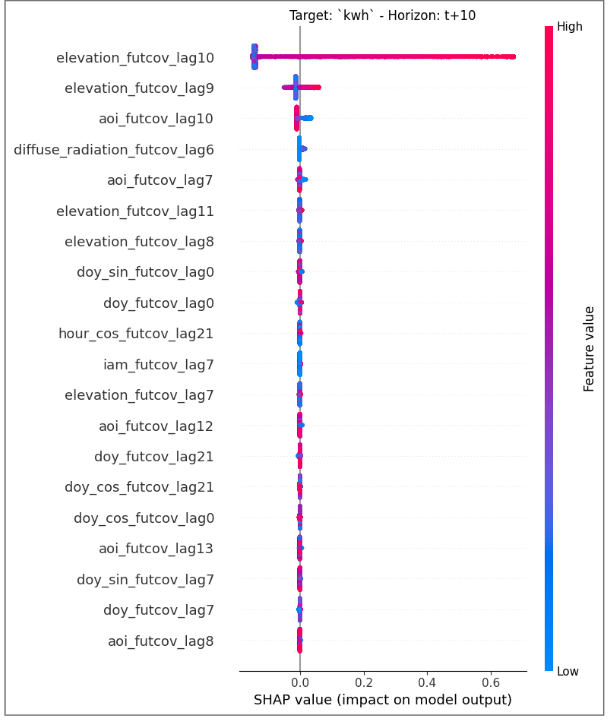

# Week 12: Engineering Lab Building Data

We now have access to a new dataset from the Tony England Engineering Lab building in Dearborn, Michigan. 

Much of the same data processing is performed as in previous datasets. Since output variance was expected to be similar to the Calgary dataset, we pull some extra weather features from Open-Meteo. 

Full list:

```url
temperature_2m,
cloud_cover,
direct_radiation,
diffuse_radiation,
global_tilted_irradiance,
weather_code,
sunshine_duration,
relative_humidity_2m,
dewpoint_2m,
wind_speed_10m,
snow_depth,
cloud_cover_low,
cloud_cover_mid,
cloud_cover_high
```

And we also compute some extra features using pvlib, including 

angle of incidence:

```python
aoi = pvlib.irradiance.aoi(
    surface_tilt=30,
    surface_azimuth=180,
    solar_zenith=solpos['zenith'],
    solar_azimuth=solpos['azimuth']
)
```

incidence angle modifiers:

```python
iam = pvlib.iam.physical(aoi)
```

and estimated cell temperature:

```python
cell_temp = pvlib.temperature.faiman(
    poa_global=weather_data['global_tilted_irradiance'],
    temp_air=weather_data['temperature_2m'],
    wind_speed=weather_data['wind_speed_10m']
)
```

This model ends up being much more accurate.

```
Overall 24h Rolling - RMSE: 0.4642 | MAE: 0.3121 | R2: 0.9982
```

We can also explore exporting SHAP data, which shows us that actually most of the weather data imported earlier is actually uneccessary.

Here is an example graph showing horizon 10, with weather features removed:



And here is a sample forecast for the model, with only solar elevation inputs.


It's a mutch better model, because this dataset includes much less noise.
