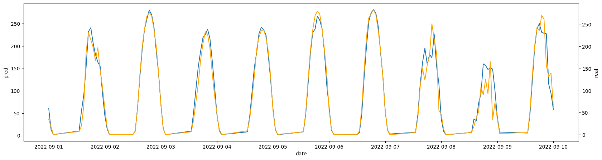

# Week 8: Improving the model

This week, we tried several methods for improving the model's performance. 

We tried switching from a random forest to two different types of gradient boosters, and performed hyperparameter tuning with optuna. The combination of these efforts resulted in a RMSE decrease of about 1 kwh, indicating we are close to the maximum accuracy we can extract from the data given.

```bash
Highest performing parameters:
n_estimators=274, 
random_state=69420, 
learning_rate=0.016402891919412303, 
max_depth=8, 
subsample=0.6358289534884547, 
colsample_bytree=0.921776337426511
```

```bash
Stats:
RMSE: 31.547821200272953 
R2: 0.8692546926059824 
MAE: 19.988706419003805
```

Time to supplement our data with weather data. It can easily be fetched from Open-Meteo.

```bash
   temperature_2m  cloud_cover  direct_normal_irradiance  diffuse_radiation  \
0             1.1          100                       0.0                3.0   
1             0.8          100                       0.0                0.0   
2             0.5           96                       0.0                0.0   
3             0.8           99                       0.0                0.0   
4             0.7           98                       0.0                0.0   

   relative_humidity_2m                      date  
0                    68 2020-01-01 00:00:00+00:00  
1                    68 2020-01-01 01:00:00+00:00  
2                    68 2020-01-01 02:00:00+00:00  
3                    67 2020-01-01 03:00:00+00:00  
4                    68 2020-01-01 04:00:00+00:00  
```

Additionally, we can add solar elevation data calculated from location and time by pvlib:

```python
times = pd.date_range("2020-01-01 00:00", "2023-03-16 23:00", freq="h", tz="UTC")
solpos = pvlib.solarposition.get_solarposition(times, LATITUDE, LONGITUDE)
elevation_df = pd.DataFrame ({
    'date': times,
    'elevation': solpos.elevation
})

data = pd.merge(data, elevation_df, on='date', how='inner', suffixes=('', '_elevation'))
```

The end result of this is a approx. 3 kwh decrease in RMSE.

```bash
Stats:
RMSE: 28.22121946383649 
R2: 0.8954817387692838 
MAE: 16.852975254651504
```

Notably, solar elevation replaces lag features as the primary feature the model relies upon

```bash
Feature Importances:
 elevation                   0.494498
kWh_lag_1                   0.157113
hour                        0.082396
direct_normal_irradiance    0.060395
temperature_2m              0.034951
cloud_cover                 0.028796
diffuse_radiation           0.019391
relative_humidity_2m        0.017167
kWh_lag_2                   0.016530
kWh_lag_3                   0.014321
month                       0.011568
kWh_lag_6                   0.011211
kWh_lag_168                 0.010810
kWh_lag_48                  0.010697
kWh_lag_24                  0.010565
kWh_lag_12                  0.010005
DOY                         0.009585
```

Here is a graph of one week to illustrate model progress:

 

Predictions are in blue, and real output is in orange.

The model no longer struggles with normal days, however in days with bad weather or otherwise abnormal power production, it still struggles to maintain accuracy.
