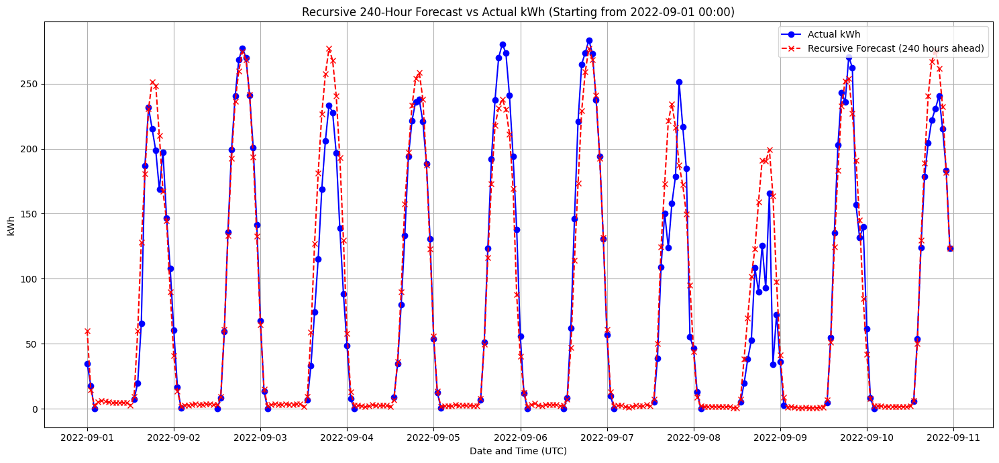

# Week 9: Predicting 24 hours ahead: The recursive approach

Currently, the model can only predict output one hour ahead (inputs rely on output lag from 1 hour ago)

We can extend this output window arbitrarily by feeding the model it's own outputs as lag features. This will decrease accuracy.

The function to do this will be shown below:

```python
def recursive_forecast(model, df_full, start_datetime, num_steps, base_feature_columns, lag_steps, train_feature_columns):
    max_lag = max(lag_steps)

    start_idx_loc = df_full.index.get_loc(start_datetime)

    initial_kwh_history = df_full.iloc[start_idx_loc - max_lag : start_idx_loc]['kWh'].tolist()

    forecasted_kwh = []
    forecasted_dates = []

    # buffer to store generated output
    current_kwh_history = list(initial_kwh_history) 

    for i in range(num_steps):
        current_forecast_datetime = df_full.index[start_idx_loc + i]
        forecasted_dates.append(current_forecast_datetime)

        # extract only non-lag features from the dataset
        current_features_series = df_full.loc[current_forecast_datetime, base_feature_columns].copy()

        # inject lag steps
        for lag in lag_steps:
            if len(current_kwh_history) >= lag:
                current_features_series[f'kWh_lag_{lag}'] = current_kwh_history[-lag]
            else:
                current_features_series[f'kWh_lag_{lag}'] = np.nan


        model_input = pd.DataFrame([current_features_series.values], columns=current_features_series.index)
        model_input = model_input[train_feature_columns]

        prediction = model.predict(model_input)[0]
        forecasted_kwh.append(prediction)

        current_kwh_history.append(prediction)
        current_kwh_history.pop(0)

    return pd.Series(forecasted_kwh, index=forecasted_dates, name='predicted_kWh_recursive')
```

Since most of this week was spent debugging this functionality, there is not much to show.

Here is a 240-hour ahead forecast for one sample week in september: (Time ahead value picked mostly for convenience)



Now, the model only predicts smooth curves for each day, because it is no longer aware of variability singaled by previous output.

Stats:

```bash
RMSE for 240-hour recursive forecast: 31.07988451019742
R2 Score for 240-hour recursive forecast: 0.8878766602876786
MAE for 240-hour recursive forecast: 20.69957200696959
```

Notably these are only for this specific forecast window, and thus are better due to this time span in particular having less variability. Evaluation for the entire dataset was too slow to implement.
